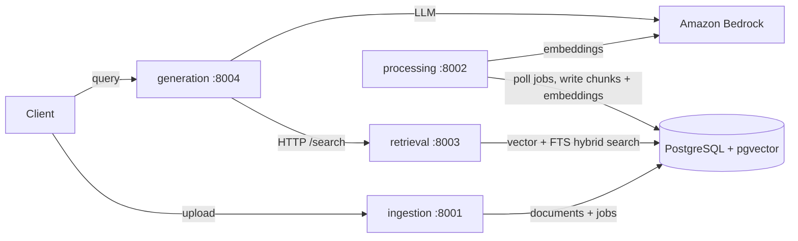

# RAG Platform

A production-grade Retrieval-Augmented Generation platform built as a
microservices monorepo, designed to scale from MVP to 10M+ documents.

## Architecture



| Service | Port | Responsibility |
|---|---|---|
| `ingestion` | 8001 | Document upload, parsing, deduplication, versioning |
| `processing` | 8002 | Async pipeline: normalization, chunking, embedding |
| `retrieval` | 8003 | Vector, full-text, and hybrid search |
| `generation` | 8004 | RAG query API: retrieval + Bedrock generation with citations |

Shared code lives in `libs/common` (settings, logging, errors, app factory,
tracing), `libs/contracts` (cross-service Pydantic models), `libs/evaluation`
(RAGAS-style answer-quality metrics, ADR-0007), and `libs/guardrails`
(prompt-injection detection, PII redaction, ADR-0008). Services never import
each other — only `libs/*` (see ADR-0002).

## Quickstart

```bash
git clone git@github.com:Magesh-Sundaravel/rag-platform.git && cd rag-platform
cp .env.example .env
uv sync --all-packages   # install everything (uv workspace)
make check               # lint + typecheck + tests
make up                  # postgres + all 4 services via docker compose
curl localhost:8001/health
```

## Development

- **Package manager:** [uv](https://docs.astral.sh/uv/) workspace, single lockfile
- **Quality gates:** Ruff (lint+format), mypy `--strict`, pytest with ≥90% coverage
- **Workflow:** spec-driven — every phase has `specs/phase-N-*/spec.md`, `design.md`, `tasks.md`
- **Docs:** `docs/adr/` for decisions, `docs/architecture/` for diagrams, `docs/setup.md` for onboarding

## Roadmap

| Phase | Scope | Status |
|---|---|---|
| 0 | Foundation: monorepo, CI, quality gates, service skeletons | ✅ |
| 1 | Document ingestion: upload, parsing, dedup, versioning | ✅ |
| 2 | Processing pipeline: jobs, workers, normalization | ✅ |
| 3 | Chunking strategies | ✅ |
| 4 | Metadata architecture | ✅ |
| 5 | Bedrock embeddings + pgvector | ✅ |
| 6 | Retrieval: vector + BM25 + hybrid + rerank | ✅ |
| 7 | Generation: Bedrock, citations, memory | ✅ |
| 8 | RAGAS evaluation framework | ✅ |
| 9 | Guardrails + OpenTelemetry | ✅ |
| 10 | AWS deployment: Terraform, ECS Fargate, RDS PostgreSQL | ⏳ |

See [PROJECT_STATUS.md](PROJECT_STATUS.md) for live progress.
