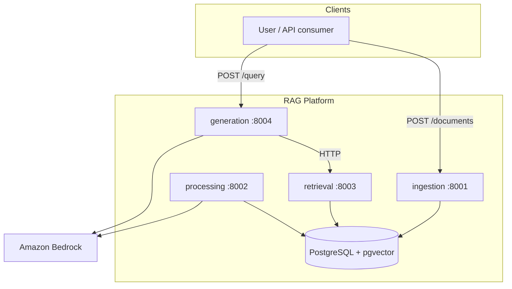
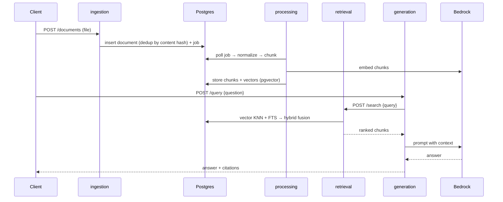

# Architecture Overview

## System context

Four FastAPI microservices in a uv-workspace monorepo, one PostgreSQL
instance with pgvector, Amazon Bedrock as the LLM provider (behind swappable
provider interfaces).

## Data flow (ingest → answer)

## Storage

One shared Postgres instance in the MVP (ADR-0004). ORM models live in
`libs/db` (`rag_db`); the ingestion service owns the single alembic
migration lineage. Tables so far: `documents` (dedup by sha256 content
hash, per-filename versioning), `jobs` (outbox for async processing).

## Async processing

The `jobs` table is the queue (ADR-0005): ingestion enqueues transactionally
(outbox), the processing service claims with `FOR UPDATE SKIP LOCKED`,
retries up to `max_attempts`, then dead-letters (`dead`) and marks the
document `failed`. Pipeline: normalize (NFKC/whitespace) → metadata (title,
language heuristic, char/token counts) → chunk (Phase 3) → embed (Phase 5).

## Chunking

Own implementation (no LangChain): `FixedSizeChunker` (character windows +
overlap) and `RecursiveCharacterChunker` (paragraph → line → sentence →
word hierarchy, greedy merge, overlap carry). Strategy/size/overlap are
env-configurable (`RAG_CHUNK_*`). Chunks persist to the `chunks` table with
JSONB metadata (title, language, filename). Semantic and parent-child
chunking are documented future work.

## Metadata filtering

Chunk metadata is flat-string JSONB (keys today: `title`, `language`,
`filename`) with a `jsonb_path_ops` GIN index. `rag_contracts.filters`
defines `MetadataFilter` (`eq` / `in`, AND semantics); retrieval translates
filters to SQL predicates in `retrieval/filters.py`.

## Embeddings

Provider protocols + deterministic fakes live in `libs/providers`
(ADR-0006). Production uses Bedrock Titan Text Embeddings V2
(`amazon.titan-embed-text-v2:0`, 1024 dims, `boto3` SDK). Chunk vectors persist to
`chunks.embedding vector(1024)` with an HNSW cosine index. Real-LLM smoke
tests run in the `llm-smoke` workflow only.

## Evaluation

`rag_evaluation` scores generation output on the four core RAGAS metrics
(faithfulness, answer relevancy, context precision/recall) via
judge-prompted scoring over the existing `GenerationProvider` abstraction —
no separate LLM-integration path (ADR-0007). A 3-example golden dataset
runs through the real Bedrock judge in the `llm-smoke` workflow.

## Guardrails and observability

`rag_guardrails` applies heuristic (regex-based, no LLM call) checks at
the generation service's `/query` boundary: prompt-injection phrase
detection rejects flagged questions before retrieval runs, and PII
redaction scrubs the answer before it's returned (ADR-0008). Tracing
(`rag_common.tracing`) instruments every service's FastAPI app; actually
exporting spans and propagating trace context over the generation ->
retrieval HTTP call is gated on `RAG_OTEL_EXPORTER_ENDPOINT` — unset (the
local/CI default) leaves tracing as a genuine no-op.

## Key decisions

See `docs/adr/`: monorepo+uv (0001), microservice boundaries (0002),
local-first/provider abstraction (0003), and later ADRs added per phase.
