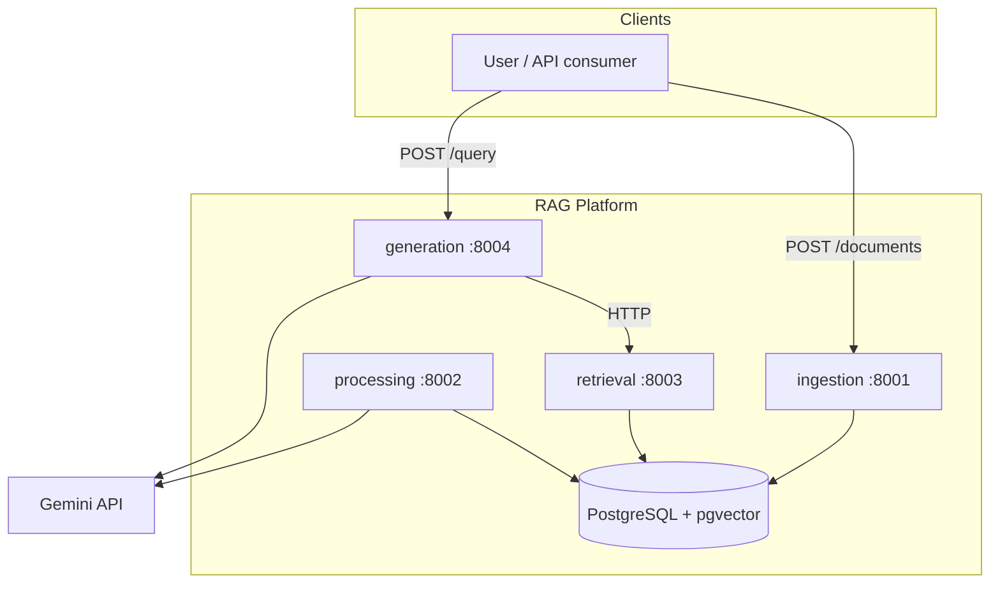

# Architecture Overview

## System context

Four FastAPI microservices in a uv-workspace monorepo, one PostgreSQL
instance with pgvector, Gemini as the LLM provider (behind swappable
provider interfaces).

## Data flow (ingest → answer)

## Key decisions

See `docs/adr/`: monorepo+uv (0001), microservice boundaries (0002),
local-first/provider abstraction (0003), and later ADRs added per phase.
